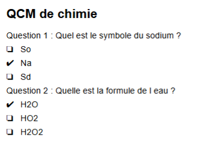
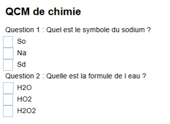
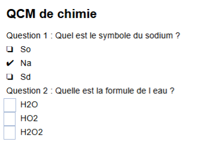
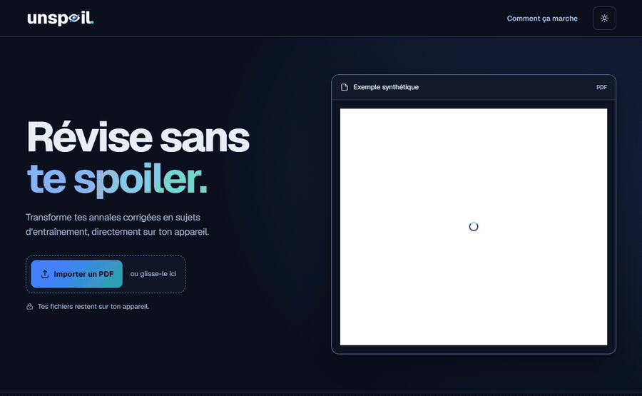
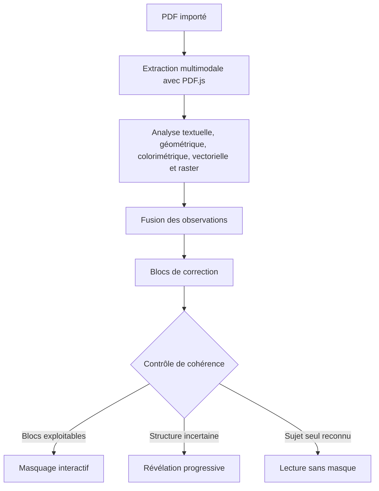

<p align="center">
  <a href="https://hsa2552.github.io/night-shift/">
    <picture>
      <source media="(prefers-color-scheme: dark)" srcset="public/brand/unspoil-sombre.svg">
      
    </picture>
  </a>
</p>

<h1 align="center">Révise sans te spoiler.</h1>

<p align="center">Transforme une annale corrigée en sujet d’entraînement. Importe un PDF, tente les questions, puis révèle chaque correction quand tu le décides.</p>

<p align="center"><strong><a href="https://hsa2552.github.io/night-shift/">Ouvrir Unspoil</a></strong> · Application web du Night Shift 2026 à l’ENSAI</p>

<p align="center">
  <a href="https://github.com/Hsa2552/night-shift/actions/workflows/ci.yml"></a>
  <a href="https://github.com/Hsa2552/night-shift/actions/workflows/deploy-pages.yml"></a>
</p>

## Pourquoi Unspoil ?

Dans beaucoup d’annales, le corrigé apparaît juste sous la question ou dans une case cochée. Il suffit de faire défiler la page pour voir la réponse avant d’avoir cherché. Unspoil conserve la mise en page du PDF et masque les corrections qu’il repère. On peut ainsi travailler à son rythme avec le document d’origine.

## Démonstration

Depuis l’accueil, « Essayer avec une annale de démonstration » ouvre un QCM synthétique dans le lecteur. Le moteur analyse ce PDF en local comme tout document importé.

Le même **QCM synthétique de chimie** dans Unspoil. Les propositions restent lisibles, les marques de réponse des QCM détectés sont uniformisées et chaque question peut être révélée séparément. [PDF de démonstration](src/detection/samples/qcm-cases.pdf)

| Réponses visibles | Corrections masquées | Première correction révélée |
| :---: | :---: | :---: |
|  |  |  |

<details>
<summary>Voir le parcours complet en 9 secondes</summary>



</details>

_Captures et GIF du build de [`b7ef36e`](https://github.com/Hsa2552/night-shift/commit/b7ef36e336c4d07cd1aafa8eab7be00b5a9b123b) dans Microsoft Edge, à partir du PDF synthétique du dépôt._ [Capture du lecteur en taille réelle](memoire/captures/readme/lecteur.png)

## Fonctionnalités

- Import local d’un PDF, couvert pendant l’analyse.
- Masquage automatique des corrections repérées et révélation ou remasquage par bloc. Sur les QCM détectés, la neutralisation porte aussi sur les cases non cochées pour éviter d’indiquer la réponse par l’apparence du masque.
- **Révélation progressive** quand la structure est trop incertaine. L’étudiant découvre alors le PDF à son rythme.
- Navigation par page, zoom, thèmes clair et sombre et application installable.

## Du PDF au masque

Le moteur déterministe croise les indices de mise en page, les marqueurs de correction, les couleurs et la géométrie des cases. PDF.js fournit le texte, les objets natifs et le rendu raster. La fusion regroupe les régions par correction, puis le lecteur vérifie les coordonnées et la cohérence du résultat avant de retirer la couverture de sécurité.



**Architecture.** Interface React, application et moteur en TypeScript, build Vite, lecteur PDF.js et service worker Workbox. Toutes les étapes s’exécutent dans le navigateur. Le lecteur et le détecteur utilisent le même repère pour que les masques restent alignés au zoom. [Architecture du dépôt](memoire/ARCHITECTURE.md) · [Contrat de coordonnées](memoire/CONTRATS.md)

Le sous-détecteur graphique natif analyse les objets des pages éligibles dans les blocs déjà établis. L’extension automatique des masques de figures, son balayage raster supplémentaire et le remplacement général de l’ordre de lecture par la segmentation adaptative restent expérimentaux. [Intégration graphique](src/detection/visual/graphic-corrections/README.md) · [Étude de géométrie](research/document-layout/README.md)

## Méthodologie et résultats

Les PDF sont identifiés par leur empreinte. Pour la validation, les régions d’énoncé et de correction sont annotées sur le rendu d’origine avant l’examen des prédictions. Les lots de développement et de validation sont distincts. Le benchmark mesure la couverture, le sur-masquage, la révélation indépendante et les indices géométriques sur les QCM. Le critère historique tolère une couverture à 95 % et un sur-masquage limité. Le critère strict exige la couverture intégrale, la préservation des énoncés annotés, la révélation indépendante des blocs annotés et l’absence d’indice mesuré. Un repli progressif ne compte pas comme réussite automatique.

**Évaluation Edge de Salif sur [`ca93897`](https://github.com/Hsa2552/night-shift/commit/ca93897ba1424e7570ab7b9ae271d5df39c13e5a)**. Les partitions ci-dessous regroupent plusieurs types de documents.

| Partition | Réussites au seuil historique | Réussites strictes | Replis progressifs |
| --- | ---: | ---: | ---: |
| Développement historique | 8/10 | 3/10 | 1/10 |
| Diagnostic vectoriel public | 0/4 | 0/4 | 2/4 |
| Validation indépendante complémentaire | 3/5 | 1/5 | 1/5 |
| Réserve indépendante v1 | 1/5 | 1/5 | 1/5 |

**QCM.** Sur le même SHA, le QCM de pratique d’Illinois PHYS214 (lot de développement complémentaire) compte 30/30 zones de réponse couvertes au seuil de 95 % et 30 blocs indépendants. Sur les six QCM ENSAI de développement, la convergence a conservé les mêmes masques et verdicts dans Edge. [Rapport de Salif](https://github.com/Hsa2552/night-shift/blob/957d56684ba55b2fe9e26c292427d581865591ae/memoire/validation-finale/resultats.md) · [Recette de convergence](memoire/QUALITE.md#v-28-0608-wb--recette-de-convergence)

**Ablations et robustesse.** Les ablations isolent l’apport des couleurs natives, des cases typographiques et des marques. Sur un QCM synthétique, les variantes de marge, d’échelle et de décoration conservent les deux blocs. La rotation de 90° déclenche le repli. Ces variantes ne sont pas des observations indépendantes. [Protocole reproductible](src/detection/eval/CORPUS.md) · [Mesures et limites](https://github.com/Hsa2552/night-shift/blob/957d56684ba55b2fe9e26c292427d581865591ae/memoire/validation-finale/resultats.md#qcm-et-robustesse)

## Confidentialité et usage hors ligne

Les PDF sont traités sur l’appareil, sans envoi, serveur de traitement, compte ni LLM à l’exécution. Le service worker met en cache les ressources de l’application. Après un premier chargement en ligne et l’activation du cache, Unspoil peut être rouvert hors ligne pour analyser un PDF enregistré sur l’appareil. L’installation dépend du navigateur. [Recette hors ligne et installation](memoire/RECETTE.md#procédure-commune-de-vérification)

## Installation et lancement

Node.js 22.13 ou plus récent. La version utilisée par la CI est indiquée dans [`.nvmrc`](.nvmrc).

```sh
git clone https://github.com/Hsa2552/night-shift.git
cd night-shift
npm ci
npm run dev       # Lancement local
npm run build     # Production dans dist/
npm run preview   # Prévisualisation du build
npm run check     # Types, lint, formatage et tests
npm test          # Tests seuls
```

[Déploiement, recette navigateur et mesures](memoire/RECETTE.md) · [Benchmark et annotations](src/detection/eval/CORPUS.md) · [Livraison et build de secours](memoire/LIVRAISON.md#convergence-finale)

## Limites et perspectives

Un corrigé sans marque claire, une figure mêlant question et réponse ou un PDF scanné peuvent laisser une correction visible, masquer une partie de l’énoncé ou entraîner une révélation progressive. Même lorsque les cases sont neutralisées, un fond coloré peut trahir la réponse. Les résultats indépendants, établis sur de petits lots, donnent la mesure de ces limites.

La suite consisterait à annoter davantage d’annales de manière croisée, à réduire le sur-masquage des tableaux et figures mixtes et à évaluer les indices visuels qui échappent au score géométrique des QCM.

## Équipe

- **Wael** — interface et expérience utilisateur, perception native, géométrie documentaire, détection graphique et intégration.
- **Hazem** — moteur algorithmique, classification, QCM, fusion des observations et gestion de l’incertitude.
- **Salif** — infrastructure PDF, PWA, distribution, benchmark et validation indépendante.
